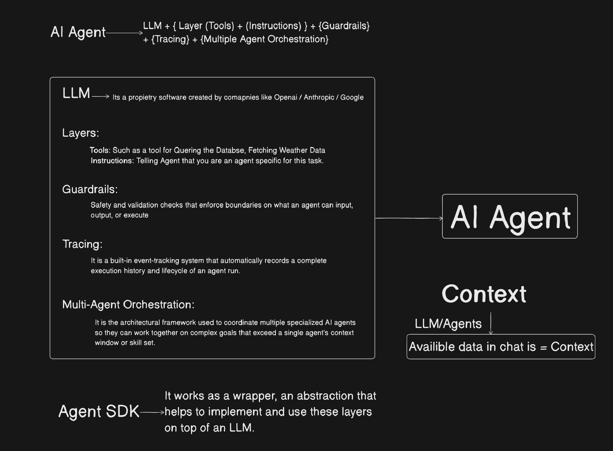
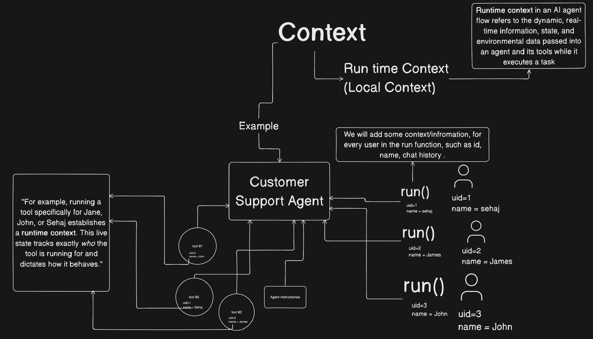

# OpenAI Agents SDK Playground

> A practical, example-driven playground for learning how to build agentic workflows with the OpenAI Agents SDK for JavaScript and TypeScript.

[](https://nodejs.org/)
[](https://openai.github.io/openai-agents-js/)
[](package.json)

This repository is a compact learning lab rather than a production application. Each file isolates one important Agents SDK concept so you can read the implementation, run it, and extend it with your own tools and workflows.

## What you’ll learn

- Create and run a basic agent
- Define tools with Zod schemas
- Call external services from a tool
- Compose agents with the manager pattern
- Route requests with agent handoffs
- Add input and output guardrails
- Preserve context across turns and conversations
- Pass private runtime context into tools
- Stream responses to the terminal
- Pause sensitive actions for human approval
- Return structured agent output

## Architecture at a glance



The examples use a small customer-support theme—sales plans, refunds, weather, and SQL—but the patterns are reusable for support bots, internal tools, workflows, and autonomous task runners.

## Quick start

### 1. Install dependencies

```bash
npm install
```

### 2. Configure your environment

Create a `.env` file in the project root:

```env
OPENAI_API_KEY=your_openai_api_key
RESEND_API_KEY=your_resend_api_key
```

`OPENAI_API_KEY` is required by the OpenAI client. `RESEND_API_KEY` is only needed for the email example in `human-loop.ts`.

Never commit `.env` or real API keys. They are ignored by `.gitignore`.

### 3. Run an example

The default development command runs the basic agent:

```bash
npm run dev
```

To try another example, run the file directly:

```bash
node agent_tool.js
node agent_manager.js
node agent_handoff.js
node input_guard.js
node output_guard.js
node conversation.js
```

The TypeScript examples are included as source examples. To execute them directly, use a TypeScript runner such as `tsx`:

```bash
npx tsx run-context.ts
npx tsx streaming.ts
npx tsx human-loop.ts
```

## Example guide

| File | Concept | What it demonstrates |
| --- | --- | --- |
| [`index.js`](index.js) | First agent | Minimal agent setup and `run()` |
| [`agent_tool.js`](agent_tool.js) | Tools + structured output | Weather lookup, email tool shape, and Zod output schemas |
| [`agent_manager.js`](agent_manager.js) | Manager pattern | A sales agent delegates refund work to a specialist agent exposed as a tool |
| [`agent_handoff.js`](agent_handoff.js) | Handoffs | A reception agent routes a request to sales or refunds |
| [`input_guard.js`](input_guard.js) | Input guardrails | Rejects prompts that are not standalone math questions |
| [`output_guard.js`](output_guard.js) | Output guardrails | Allows only read-only `SELECT` SQL output |
| [`conversation.js`](conversation.js) | In-memory history | Carries `result.history` into a follow-up turn |
| [`create-conv.js`](create-conv.js) | Conversations API | Creates a persistent OpenAI conversation thread |
| [`server-conv.js`](server-conv.js) | Server-side conversation | Reuses a conversation by ID |
| [`run-context.ts`](run-context.ts) | Runtime context | Makes user-specific execution data available to tools without exposing secrets to the model |
| [`streaming.ts`](streaming.ts) | Streaming | Pipes generated text to a Node.js stream |
| [`human-loop.ts`](human-loop.ts) | Human-in-the-loop | Pauses an email action until a person approves or rejects it |

The recommended reading order is also captured in [`filesOrder.md`](filesOrder.md).

## Core patterns

### Tools

Tools are ordinary functions wrapped with a name, description, Zod parameter schema, and executor. The model decides when to call them; your code performs the actual work.

```js
const getWeather = tool({
  name: 'getWeather',
  description: 'Get weather for a city',
  parameters: z.object({ city: z.string() }),
  execute: async ({ city }) => getWeatherFromYourService(city),
});
```

### Manager vs. handoff

- **Manager pattern:** one agent remains in control and calls specialist agents as tools.
- **Handoff pattern:** a triage agent transfers the conversation to the specialist best suited to handle it.

The repo includes both approaches side by side in `agent_manager.js` and `agent_handoff.js`.

### Guardrails

Guardrails let you validate input before an agent runs or validate output before it is accepted. The SQL example intentionally blocks destructive operations and is a starting point for stronger parsing and policy enforcement.

### Human approval

`human-loop.ts` marks the email tool with `needsApproval: true`. When the agent requests the tool, execution pauses, the user is prompted in the terminal, and the run resumes only after approval or rejection.



## Important demo notes

This is an educational playground, so several integrations are intentionally simplified:

- Broadband plans are hardcoded sample data.
- Refunds are appended to [`refunds.txt`](refunds.txt), not processed by a payment provider.
- The SQL executor logs queries instead of connecting to a database.
- The email tool uses Resend’s HTTP API and requires a valid sender/domain setup.
- `server-conv.js` contains a sample conversation ID; create your own conversation before using it.
- The examples invoke agents immediately when their files are run.

Before using these patterns in production, add authentication, authorization, input validation, retries, observability, rate limits, secret management, and real persistence.

## Project structure

```text
.
├── Images/                  # Concept diagrams
├── index.js                 # Minimal agent
├── agent_tool.js            # Tools and structured output
├── agent_manager.js         # Manager pattern
├── agent_handoff.js         # Agent handoffs
├── input_guard.js           # Input guardrail
├── output_guard.js          # Output guardrail
├── conversation.js          # In-memory conversation history
├── create-conv.js           # Create an OpenAI conversation
├── server-conv.js           # Reuse a conversation by ID
├── run-context.ts           # Runtime context
├── streaming.ts             # Response streaming
├── human-loop.ts            # Human approval workflow
└── filesOrder.md            # Suggested learning sequence
```

## Useful links

- [OpenAI Agents SDK for JavaScript](https://openai.github.io/openai-agents-js/)
- [OpenAI API documentation](https://platform.openai.com/docs/)
- [Zod documentation](https://zod.dev/)
- [Resend documentation](https://resend.com/docs)

## License

This project is released under the ISC License. See [`package.json`](package.json) for the package metadata.
